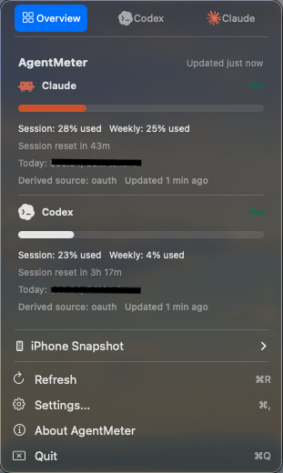
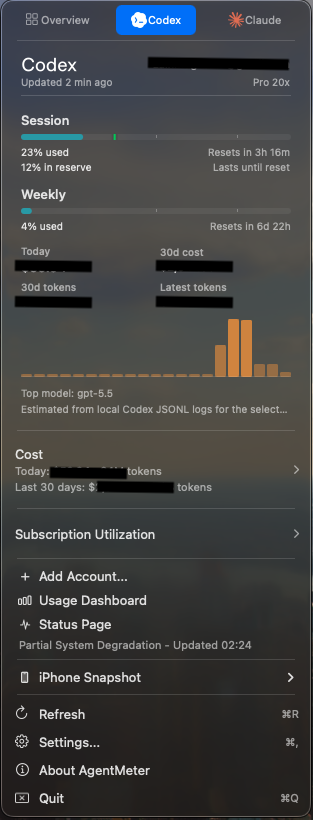
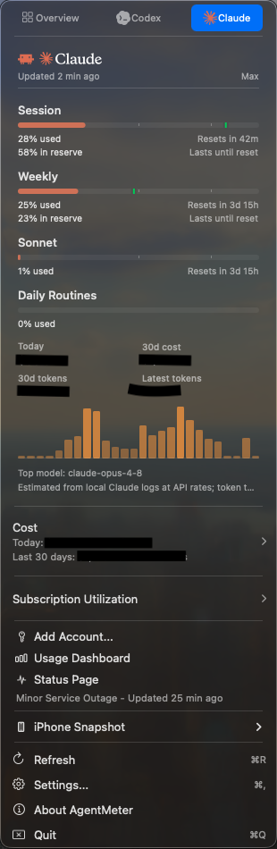
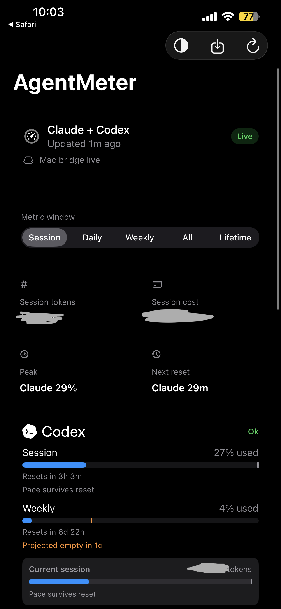
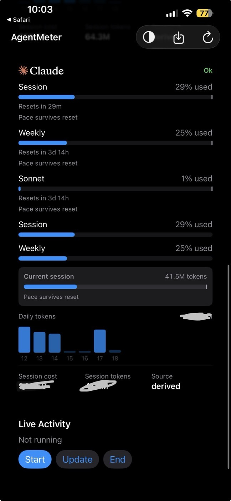

<div align="center">
  

  # AgentMeter

  **AI usage limits, reset windows, and spend without leaving your menu bar.**

  [](LICENSE)
  
  
  

  <sub>AgentMeter runs locally on your Mac and syncs to your iPhone over your LAN.</sub>
</div>

## What it is

AgentMeter is a macOS menu-bar app with an iPhone companion, widget, and Live Activity for tracking AI coding-assistant usage. It keeps the numbers that matter in view: session caps, weekly/monthly windows, reset countdowns, token usage, and estimated spend.

It is Claude- and Codex-first, with broader provider coverage inherited from [CodexBar](https://github.com/steipete/CodexBar).

## What AgentMeter adds

AgentMeter is a fork of [CodexBar](https://github.com/steipete/CodexBar) by Peter Steinberger. CodexBar provides the Mac provider engine, menu-bar foundation, broad provider adapters, and much of the packaging base. AgentMeter keeps that foundation and adds:

- iPhone app, home-screen widget, and Live Activity for Claude/Codex windows.
- Local Mac-to-iPhone sync over Bonjour, with no cloud service.
- HMAC-SHA256 request signing with nonce/timestamp replay protection.
- Sanitized phone snapshots that reject secret-shaped data before serving.
- Keychain-backed pairing and provider credential storage.
- AgentMeter identity, icon, docs, app packaging, and source-release cleanup.
- Claude/Codex-first defaults with source-confidence labels for brittle provider data.
- Several Claude subscriptions on one Mac: with [claude-swap](https://github.com/realiti4/claude-swap)
  installed, every account gets its own limit card, and 30-day token use is split per subscription.
- Stale readings say how old they are and why, for example "Last reading 2d ago; Anthropic is
  rate-limiting the usage check; retry 16:51", and a limit whose reset has passed reads 0.
- A private usage file other tools can read: 30-day totals by user, subscription, model and token
  type. See [docs/usage-export.md](docs/usage-export.md).

## Screenshots

<table>
  <tr>
    <td align="center"></td>
    <td align="center"></td>
    <td align="center"></td>
  </tr>
  <tr>
    <td align="center"><sub>Menu overview</sub></td>
    <td align="center"><sub>Codex limits</sub></td>
    <td align="center"><sub>Claude limits</sub></td>
  </tr>
</table>

<p align="center">
  
  
</p>

These screenshots show the real app with sensitive values redacted.

## Install

There is no prebuilt download. You build AgentMeter from source and sign it on your own Mac, which
takes about five minutes and needs no paid Apple account. Pick one route.

### Route 1: ask your coding agent

Paste this into Claude Code, Codex or any agent that can run shell commands on your Mac:

```text
Install AgentMeter on this Mac from source, from https://github.com/zippyg/AgentMeter.

1. Check macOS is 14 or newer (sw_vers). Check the Xcode command line tools exist
   (xcode-select -p). If they are missing, tell me to run `xcode-select --install`
   and wait for me; do not try to click through the installer yourself.
2. Clone the repo into ~/Developer/AgentMeter (or update it with git pull if it is
   already there) and cd into it.
3. Build and test with the native build system, which this package needs:
     swift build --build-system native -c release --product AgentMeter
     swift test --build-system native --filter AgentMeter
   If the build fails, show me the first error and stop.
4. Package, install and verify:
     ./Scripts/agentmeter_package_local_app.sh
     ./Scripts/agentmeter_install_local_artifact.sh
     ./Scripts/agentmeter_verify_local_app.sh /Applications/AgentMeter.app
   The package script signs with my Apple Development certificate if I have one,
   otherwise it signs locally (ad-hoc), which is fine for my own Mac. If macOS
   shows a Keychain prompt for codesign, tell me to approve it; never type a
   password yourself.
5. Launch it with `open -a /Applications/AgentMeter.app` and tell me to look for
   the robot icon in the menu bar.
6. Report the installed version (CFBundleShortVersionString and CFBundleVersion
   from /Applications/AgentMeter.app/Contents/Info.plist) and the signing
   authority (codesign -dv /Applications/AgentMeter.app).

Do not change the bundle identifier, do not enable any provider I have not asked
for, and do not send anything off this Mac.
```

To update later, ask the agent to run the same steps again; it pulls, rebuilds and replaces the
app in place.

### Route 2: build it yourself

Requirements: macOS 14 or newer, and the Xcode command line tools (`xcode-select --install`).

```bash
git clone https://github.com/zippyg/AgentMeter.git
cd AgentMeter
make start-release
```

`make start-release` builds the release binary, packages `AgentMeter.app`, signs it, verifies it
and installs it to `/Applications`. Then open it:

```bash
open -a /Applications/AgentMeter.app
```

AgentMeter has no Dock icon. Click the robot in the menu bar to open the dashboard.

To try it without installing, run `make start` (a debug build straight from the source tree).

### How signing works

You never need a paid Apple Developer account to run AgentMeter on your own Mac.

| You have | What happens |
| --- | --- |
| No certificate | Signed ad-hoc. Runs on this Mac only. |
| Free or paid Apple Development certificate in Xcode | Signed with it automatically. |
| A specific identity you want | `AGENTMETER_CODESIGN_IDENTITY="Apple Development: Your Name (TEAMID)" make start-release` |

List your identities with `security find-identity -v -p codesigning`. If macOS asks to let
`codesign` use a key in your Keychain, choose Always Allow.

Keep signing with the same identity once installed. Switching identity makes macOS treat it as a
different app, so it may ask again for Keychain and Local Network access, and the iPhone app may
need pairing again.

### Why `--build-system native`

Swift 6.4's default build system rejects this package (`duplicatedTargetIdentifier` on the
resource bundle). The Makefile passes `--build-system native` for you. If you call `swift`
directly, add the flag yourself.

## Pair the iPhone app

1. Open `AgentMeteriOS/AgentMeteriOS.xcodeproj` in Xcode.
2. Set your own signing team and bundle identifiers.
3. Build the `AgentMeteriOS` scheme to your iPhone.
4. On the Mac, open AgentMeter and choose the iPhone snapshot/pairing action.
5. Open the pairing link or QR on the phone.

The phone stores a per-device token in the iOS Keychain and discovers the Mac over Bonjour. macOS may ask for Local Network access on first use.

## Privacy model

- No telemetry.
- No hosted backend.
- Provider credentials stay on the Mac and belong in Keychain.
- The iPhone receives a usage-only snapshot, not provider cookies, access tokens, or raw cache files.
- The local bridge uses an OS-assigned port and advertises `_agentmeter._tcp` over Bonjour.
- Authenticated bridge requests are signed and replay-protected.

Provider data quality varies. Official APIs are preferred, local CLI/cache sources are second best, and unofficial/private endpoints are labeled as brittle rather than presented as perfect truth.

## Providers

Claude and Codex are the primary supported path. AgentMeter also inherits CodexBar's wider provider matrix, including Cursor, Gemini, Copilot, OpenRouter, OpenAI API, and others. Enable only the providers you actually use.

## Common commands

```bash
make build
make test
make lint

make release
./Scripts/agentmeter_verify_local_app.sh .agentmeter-artifacts/AgentMeter-*.app
```

The package script wraps the existing release binary. If you call it directly after changing
Swift code, run `swift build --build-system native -c release --product AgentMeter` first.

## Several Claude accounts

AgentMeter works with one Claude account out of the box. If you rotate between several with
[claude-swap](https://github.com/realiti4/claude-swap), AgentMeter reads its account list
(`cswap list --json`, read-only; it never switches accounts) and shows:

- one limit card per account, with the active one marked;
- why a card is stale and when it will retry;
- a "By subscription" split of this Mac's 30-day token use, matched from each session's own
  account markers and, for older sessions, claude-swap's switch log.

Account ids are hashed before they are stored, and nothing is sent off the Mac. Costs are
API-equivalent estimates, not what a subscription bills.

## Forking and rebranding

AgentMeter pins its macOS menu-bar identity on purpose. Do not casually change the bundle id, status-item autosave name, or Background Task Management identity in an existing install.

For a clean fork, follow [docs/FORKING.md](docs/FORKING.md). It covers the Swift identity prefix, macOS bundle id, iOS bundle ids, App Groups, icons, and release configuration.

## Credits

AgentMeter is built on [CodexBar](https://github.com/steipete/CodexBar), Copyright (c) 2026 Peter Steinberger, MIT licensed.

AgentMeter changes are Copyright (c) 2026 Zain Mughal and are also MIT licensed. See [LICENSE](LICENSE).
